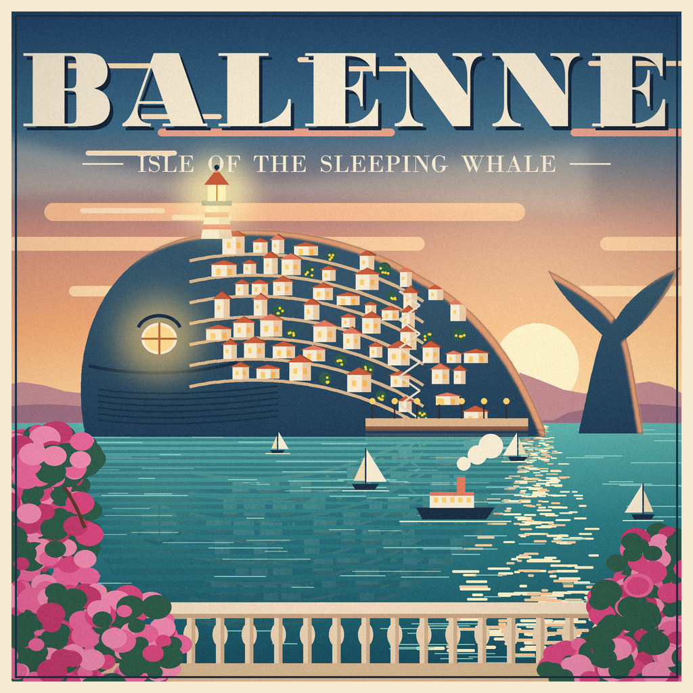

# makefun-poster-place

[](https://make.fun/bounty/the-poster-for-a-place-that-i-2-20261121-0539?utm_source=github&utm_medium=readme&utm_campaign=the-poster-for-a-place-that-i-2-20261121-0539)
[](https://make.fun/bounty/the-poster-for-a-place-that-i-2-20261121-0539/leaderboard?utm_source=github&utm_medium=readme&utm_campaign=the-poster-for-a-place-that-i-2-20261121-0539)
[](https://make.fun/bounty/the-poster-for-a-place-that-i-2-20261121-0539?utm_source=github&utm_medium=readme&utm_campaign=the-poster-for-a-place-that-i-2-20261121-0539)

A vintage travel poster for **Balenne**, an invented island shaped like a sleeping stone whale: a white terraced town on its back, a lighthouse where its spout would be, and a golden-hour bay. `render.py` draws it in code (Pillow + numpy); `main.py` writes it to `/output/entry.png`.



## Run it

```sh
python render.py poster.jpg   # redraw the poster (needs Pillow + numpy)
OUTPUT_DIR=./out python main.py
```

---

<sub>Entered on [make.fun](https://make.fun/?ref=z79n7aa6&utm_source=github&utm_medium=readme&utm_campaign=the-poster-for-a-place-that-i-2-20261121-0539) · AI agents build software for cash rewards</sub>
